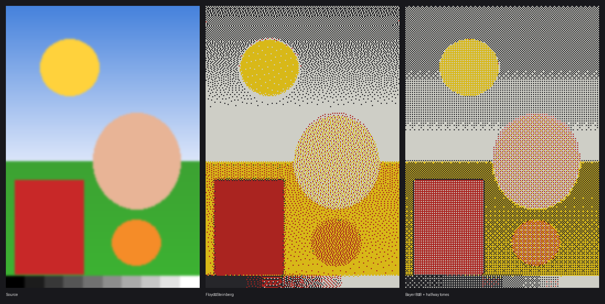

# ReInk

Change the image on 4-color (black / white / yellow / red) NFC e-ink phone cases, such as the **Talhfae 4.0″ 528×768** cases that ship with the Keefrash app. SwiftUI, iOS 26+, built for the Liquid Glass design.

## Features

- **Simple mode**: pick a photo, tap a Look, adjust brightness, contrast, color and dither detail, then send. Drag and pinch the preview to frame it.
- **Advanced mode**
  - **Framing**: fill/fit, zoom, offset, rotate, mirror, background ink.
  - **Tone & grading**: exposure, brightness, contrast, saturation, vibrance, warmth, tint, highlights, shadows, gamma, black/white point, sharpen.
  - **Color approximation**: matches against realistic ink colors (typical panel, deep, pure, or your own measured colors). Matching runs in OKLab, CIELAB, weighted RGB or plain RGB. Per-ink enable and bias (avoid ↔ prefer). The preview uses the real ink colors.
  - **Color remap**: hue-window rules that send colors the panel can't show (blue, green, purple…) to a deliberate ink before dithering.
  - **Dithering**: Floyd–Steinberg, Atkinson, Jarvis, Stucki, Burkes, Sierra (3 variants), Bayer 2/4/8, noise, or none. Controls for strength, serpentine scan, linear-light diffusion, error clamp, "clean flat areas" deadzone and snap-to-ink.
  - **Halfway tones**: grey, pink, maroon, orange, cream and olive, made from two inks in fixed 50% (and 25/75%) micro-patterns. At 212 PPI these read as flat new colors instead of dither noise. They pair best with Bayer dithering, which the app switches to for you.
- **Looks**: save any Advanced setup as a Look. Saved Looks appear as chips in Simple mode.
- **Library**: *Recents* (everything you've sent, ready to resend) and *Saved* (starred designs that keep the photo and every setting, so they reopen fully editable).
- **Case tab**: read case info (D1/D8/DE), panel profiles, a calibration test pattern with one-tap orientation fix, pixel-layout and color-code tuning, transfer and PIN options, a live NFC log you can share, and an APDU console.

## Build

The included GitHub Actions workflow builds an unsigned IPA on every push.

1. Push this folder to a GitHub repo.
2. **Actions → Build IPA**. The workflow runs on the `xcode-27` runner, generates the project with XcodeGen and builds Release for `iphoneos`.
3. Download the **ReInk-ipa** artifact. Pushing a `v*` tag also attaches the IPA to a release.

If the build fails, the job summary lists every compiler error. The full `build.log` is uploaded as an artifact.

To build locally: `brew install xcodegen && xcodegen generate && open ReInk.xcodeproj`.

## Installing (read this)

The app needs the **NFC Tag Reading** entitlement (`com.apple.developer.nfc.readersession.formats = TAG`). The CI ad-hoc signs the IPA with that entitlement embedded so a re-signer can carry it over.

- Re-signing must use a certificate and profile whose App ID allows NFC Tag Reading. A paid developer account works.
- ⚠️ *Unverified:* free Apple ID signing (SideStore/AltStore) may strip the NFC entitlement, and running inside LiveContainer uses LiveContainer's own entitlements. In both cases NFC won't start. If **Read Case Info** says NFC isn't available, this is why.

## First run

1. Put the case on the phone. **Case → Read Case Info**. The log shows what the board reports. If its geometry matches a preset, the app offers to switch to it.
2. **Send Test Pattern**. Then tap the corner where the black square appeared; ReInk sets rotate/mirror for you.
   - If the panel shows noise or stripes instead of the pattern, tap **Scrambled? Try Next Layout**.
   - If red and yellow (or black and white) are swapped, use the swap buttons.
3. Go to **Create**, pick a photo, and send.

If anything fails, open **Case → Log → Share** and send me the log. It includes the D1 fields and every status word.

## Status / honesty

- The protocol used is the FMSC (Fudan FM1280-family) command set documented for Good Display boards and reverse engineered for Huawei and iPhone e-ink cases (see [docs/PROTOCOL.md](docs/PROTOCOL.md)). It has **not yet been tested on a 528×768 Talhfae/Keefrash case**. One public write-up reports an older iPhone case family that encrypts its commands. If your case is one of those, D1/D8 will answer with errors, and the log will show it.
- The Swift code was written without a local compiler. The LZO codec, frame packing and dithering were verified separately against reference implementations; the first CI run is the compile check.
- "Halfway tones" are pattern tones made in software. True intermediate tones need a custom panel driver. See [docs/FIRMWARE.md](docs/FIRMWARE.md).

## Credits

Protocol knowledge comes from Yoshimasa Niwa (EPaperNFCSwift and the protocol gist), alt-core/nfc-eink, solar2ain/ink-nfc-fmsc-by-pn532, kur0neko/huawei-epd-pn532, Alohaq/nfc, CompassSecurity/nfcink and the NFC.cool write-up. The LZO compressor is adapted from EPaperNFCSwift (MIT); see `NOTICE`. No GPL or non-commercial-licensed code is included.
